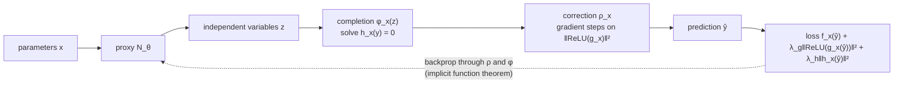

# L2ODC3.jl

[](https://github.com/LearningToOptimize/L2ODC3.jl/actions/workflows/CI.yml?query=branch%3Amain)
[](https://app.codecov.io/gh/LearningToOptimize/L2ODC3.jl)
[](https://LearningToOptimize.github.io/L2ODC3.jl/dev/)
[](https://LearningToOptimize.github.io/L2ODC3.jl/stable/)
[](https://github.com/JuliaDiff/BlueStyle)

L2ODC3.jl trains neural-network proxies for parametric optimization problems
with **hard constraints**. It implements **DC3**, *Deep Constraint Completion
and Correction* ([Donti, Rolnick & Kolter, ICLR 2021](https://arxiv.org/abs/2104.12225)).
The proxy predicts only the *independent* variables. The equality constraints
are solved for the rest, in closed form for affine equalities and by Newton's
method with implicit-function-theorem derivatives otherwise, so every
prediction satisfies them exactly. Unrolled gradient steps along the equality
manifold then remove the inequality violation. Training is self-supervised:
the loss is the objective plus a soft penalty, and no solver labels are needed.
The package also implements **FSNet**
([Nguyen & Donti, 2025](https://arxiv.org/abs/2506.00362)), which predicts every
variable and descends the total violation `‖h‖² + ‖ReLU(g)‖²` to a feasible
point. Problems are written in JuMP. The package works with any proxy and any
ChainRules-compatible AD, and affine problems run on GPU arrays.



## Installation

L2ODC3 builds on `L2OCore`, the shared interface of the
[LearningToOptimize](https://github.com/LearningToOptimize) ecosystem. Until
both are registered:

```julia
using Pkg
Pkg.add(url="https://github.com/LearningToOptimize/LearningToOptimize.jl",
        subdir="lib/L2OCore", rev="ar/l2ocore-design")
Pkg.add(url="https://github.com/LearningToOptimize/L2ODC3.jl")
```

## Example

```julia
using L2ODC3, L2OCore, JuMP, Zygote
import MathOptInterface as MOI

# Parametric QP: x are the parameters, y the decisions.
model = Model()
@variable(model, x[1:2] in MOI.Parameter.(zeros(2)))
@variable(model, -1 <= y[1:4] <= 1)
@constraint(model, y[1] + y[2] + y[3] == x[1])
@constraint(model, y[2] - y[4] == x[2])
@objective(model, Min, sum(y .^ 2) + y[1] - y[3])

pipe = L2OPipeline(ParametricProblem(model), DC3())

# Any callable is a proxy; here an affine map z = W x + b trained by gradient descent.
W, b = zeros(output_dimension(pipe), 2), zeros(output_dimension(pipe))
for _ in 1:300
    X = rand(2, 64) .- 0.5
    gW, gb = Zygote.gradient((W, b) -> loss(pipe, X, W * X .+ b), W, b)
    W .-= 0.1 .* gW
    b .-= 0.1 .* gb
end

X = rand(2, 5) .- 0.5
pred = complete(pipe, X, W * X .+ b)               # completion + correction
check(EqualityFeasible(), pipe.problem, X, pred)   # equalities hold to round-off
evaluate(pipe, X, pred)                            # objective and violations
```

The [documentation](https://LearningToOptimize.github.io/L2ODC3.jl/dev/) has a
complete example. It trains a Lux network with DC3 and with FSNet on the convex
QP of the DC3 paper and compares both with HiGHS.

## What you need to provide

- A **JuMP model with parameters** (`@variable(m, p in MOI.Parameter(v))`). The
  parameters are the proxy inputs. Constraints use box-like sets (`==`, `<=`,
  `>=`, intervals, variable bounds); functions may be affine, quadratic or
  nonlinear.
- A **proxy**: any callable from `num_parameters × B` to
  `output_dimension(pipe) × B` (a Lux or Flux network, a closure, an affine map).
- A **training loop** in the framework of your choice, minimizing
  `loss(pipe, X, proxy(X))`.
- For nonlinear problems, a correction `step_size` and start values for the
  Newton completion.

## What you get

| | DC3 | FSNet |
|:--|:--|:--|
| proxy predicts | independent variables | all variables |
| equalities | exact (round-off for affine, Newton tolerance otherwise) | approximate, driven to 0 |
| inequalities | unrolled correction on the equality manifold | unrolled descent on the total violation |
| problem classes | LP, QP, smooth NLP | LP, QP, smooth NLP |
| GPU (affine problems) | yes (`Adapt.adapt(CuArray, pipe.decomposition)`) | yes |

Every mathematical claim is a named, numerically checked guarantee:
`EqualityFeasible`, `CompletionJacobian` (implicit-function-theorem
derivatives match finite differences), `CorrectionDescent` and
`FeasibilitySeekingDescent` (the violation does not increase for steps
`≤ 1/L`). The [Theory](https://LearningToOptimize.github.io/L2ODC3.jl/dev/theory/)
page states their assumptions.

## The LearningToOptimize ecosystem

- [LearningToOptimize.jl](https://github.com/LearningToOptimize/LearningToOptimize.jl):
  the `L2OCore` interface (parametric problems, pipelines, evaluators,
  guarantees), basic methods and data generation.
- [L2ODLL.jl](https://github.com/LearningToOptimize/L2ODLL.jl): dual Lagrangian
  learning, i.e. dual proxies with valid bounds.
- [DecisionRules.jl](https://github.com/LearningToOptimize/DecisionRules.jl):
  decision rules for multistage stochastic programs.
- **L2ODC3.jl**: primal proxies with hard constraints (DC3, FSNet).

## Citation

If you use this package, please cite the methods it implements (and this
package, see [`CITATION.cff`](CITATION.cff)):

```bibtex
@inproceedings{donti2021dc3,
  title     = {{DC3}: A learning method for optimization with hard constraints},
  author    = {Donti, Priya L. and Rolnick, David and Kolter, J. Zico},
  booktitle = {International Conference on Learning Representations},
  year      = {2021},
  url       = {https://arxiv.org/abs/2104.12225},
}
@article{nguyen2025fsnet,
  title   = {{FSNet}: Feasibility-Seeking Neural Network for Constrained Optimization with Guarantees},
  author  = {Nguyen, Hoang T. and Donti, Priya L.},
  journal = {arXiv preprint arXiv:2506.00362},
  year    = {2025},
}
```
