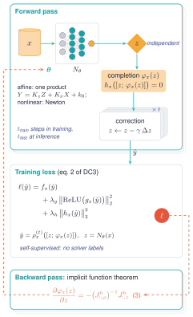

# L2ODC3.jl

```@raw html
<p class="eyebrow">Equality completion · Inequality correction · Hard constraints</p>
<figure class="fig hero has-compact">
```
![DC3, deep constraint completion and correction. Forward pass: the proxy N_theta maps the parameters x to the independent variables z; the equality completion phi_x of z solves h_x of z and phi_x of z equal to zero (one matrix product for affine equalities, Newton's method otherwise); t unrolled correction steps, z replaced by z minus gamma Delta z and re-completed, reduce the inequality violation (t_train steps in training, t_test at inference), giving y-hat. Training loss (eq. 2 of DC3): ell of y-hat equals f_x of y-hat plus lambda_g times the squared norm of ReLU of g_x of y-hat plus lambda_h times the squared norm of h_x of y-hat; self-supervised, no solver labels. Backward pass: gradients return to theta through the unrolled corrections and, by the implicit function theorem, through the completion, d phi_x / dz equals minus the inverse of J^h with respect to phi times J^h with respect to z (eq. 3).](assets/diagrams/l2odc3--completion-correction.svg)


```@raw html
<figcaption><i>The proxy predicts the independent variables; the equalities are solved for the rest, unrolled correction steps reduce the inequality violation, and the soft loss trains the proxy through both.</i></figcaption>
</figure>
```

L2ODC3.jl trains neural-network proxies for parametric optimization problems
that must satisfy hard constraints. It implements two methods on the
`L2OCore` interface of the
[LearningToOptimize](https://github.com/LearningToOptimize) ecosystem:

- [`DC3`](@ref), *Deep Constraint Completion and Correction*
  ([Donti, Rolnick & Kolter, ICLR 2021](https://arxiv.org/abs/2104.12225)). The
  proxy predicts a subset of the variables, and the equality constraints are
  solved for the rest (exactly for affine equalities, by Newton's method
  otherwise), so every prediction satisfies them. Unrolled gradient steps
  along the equality manifold then remove the inequality violation. Training
  is self-supervised with a soft penalty loss.
- [`FSNet`](@ref), *Feasibility-Seeking Neural Network*
  ([Nguyen & Donti, 2025](https://arxiv.org/abs/2506.00362)). The proxy
  predicts every variable, and unrolled gradient descent on the total violation
  ``\|h\|^2 + \|\mathrm{ReLU}(g)\|^2`` moves the prediction to a feasible point.

Problems are JuMP models with parameters. The core is framework-agnostic: any
callable proxy and any ChainRules-compatible AD (Zygote is tested). Affine
problems run on GPU arrays.

## Installation

The registered LearningToOptimize 1.0.0 predates the `L2OCore` interface.
Until `L2OCore` and L2ODC3 are registered, install `L2OCore` from the
`lib/L2OCore` folder of LearningToOptimize.jl first, then this package (Julia
1.10 or later):

```julia
using Pkg
Pkg.add(url="https://github.com/LearningToOptimize/LearningToOptimize.jl", subdir="lib/L2OCore")
Pkg.add(url="https://github.com/LearningToOptimize/L2ODC3.jl")
Pkg.add("JuMP")   # to write problems
```

The [example](examples/dc3_qp.md) also uses HiGHS, Lux, Optimisers and Zygote.

## Where to go next

- [Theory](theory.md): the methods as optimization problems, their
  derivatives and step sizes, and where the package departs from the papers.
- [Package guide](guide.md): getting started, concepts, GPU, AD support and
  extension points.
- [Example](examples/dc3_qp.md): training a DC3 and an FSNet proxy on the
  convex QP of the DC3 paper and comparing with HiGHS.
- [API reference](api.md).

## Citing

If you use DC3 or FSNet, cite the original papers (see `CITATION.cff` in the
repository for this package):

```bibtex
@inproceedings{donti2021dc3,
  title     = {{DC3}: A learning method for optimization with hard constraints},
  author    = {Donti, Priya L. and Rolnick, David and Kolter, J. Zico},
  booktitle = {International Conference on Learning Representations},
  year      = {2021},
}
@article{nguyen2025fsnet,
  title   = {{FSNet}: Feasibility-Seeking Neural Network for Constrained Optimization with Guarantees},
  author  = {Nguyen, Hoang T. and Donti, Priya L.},
  journal = {arXiv preprint arXiv:2506.00362},
  year    = {2025},
}
```
